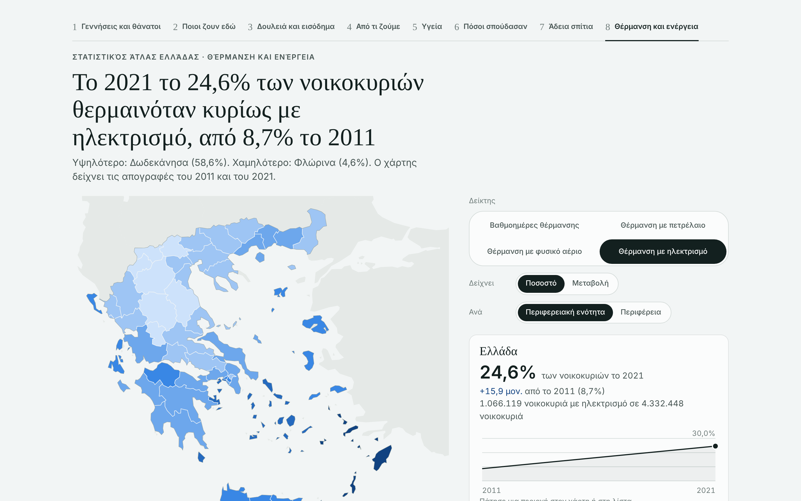
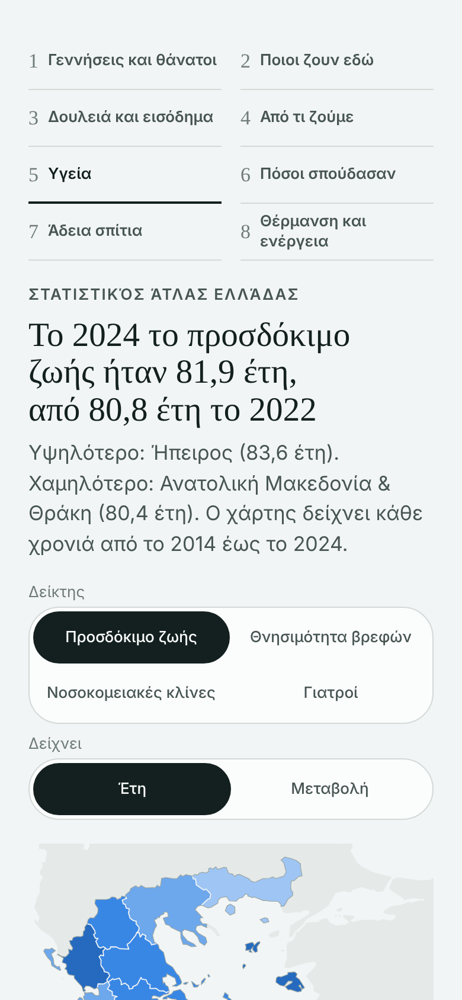
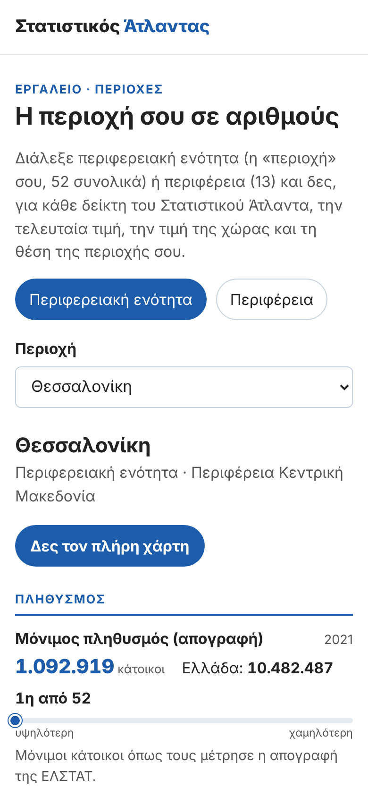

# Στατιστικός Άτλαντας

**Η Ελλάδα σε αριθμούς, ανά περιοχή, με ελεγμένες πηγές.** 
*Greece in numbers, region by region, with checked sources.*

[**Χάρτης**](https://tools.statistikosatlantas.com/xartis/) ·
[**Εργαλεία**](https://tools.statistikosatlantas.com/) ·
[**Blog**](https://statistikosatlantas.com) ·
[English](#english)

Ο Στατιστικός Άτλαντας είναι ένα ανεξάρτητο εγχείρημα δημοσιογραφίας δεδομένων. Παίρνει τα επίσημα στοιχεία της ΕΛΣΤΑΤ και της Eurostat και τα δείχνει εκεί που τα ζει ο καθένας: στην περιφέρεια και στην περιφερειακή ενότητα του.

## Ο χάρτης

**[tools.statistikosatlantas.com/xartis](https://tools.statistikosatlantas.com/xartis/)**

30 δείκτες σε 8 ιστορίες, για τις 13 περιφέρειες και τις 52 περιφερειακές ενότητες:

| Ιστορία | Τι δείχνει |
|---|---|
| Γεννήσεις και θάνατοι | γεννήσεις, θάνατοι, φυσική μεταβολή, γονιμότητα, μητέρες 40+, ηλικία μητέρας |
| Ποιοι ζουν εδώ | πληθυσμός απογραφής, γήρανση, κάτοικοι χωρίς ελληνική ιθαγένεια |
| Δουλειά και εισόδημα | ανεργία, απασχόληση, ΑΕΠ, εισόδημα νοικοκυριών, κίνδυνος φτώχειας |
| Από τι ζούμε | πρωτογενής τομέας, τουρισμός, διανυκτερεύσεις |
| Υγεία | προσδόκιμο ζωής, βρεφική θνησιμότητα, νεκροί σε τροχαία, γιατροί, νοσοκομειακές κλίνες |
| Πόσοι σπούδασαν | απόφοιτοι τριτοβάθμιας (απογραφή και έρευνα εργατικού δυναμικού) |
| Άδεια σπίτια | κενές κατοικίες |
| Θέρμανση και ενέργεια | βαθμοημέρες θέρμανσης, πετρέλαιο, φυσικό αέριο, ρεύμα |

Κάθε δείκτης έχει χρονοσειρά, σύγκριση με τη χώρα, κατάταξη και σημειώσεις για ό,τι δεν συγκρίνεται: αλλαγές μεθόδου, μικρούς αριθμούς, προσωρινά στοιχεία.

&nbsp;&nbsp;

## Τα εργαλεία

| Εργαλείο | |
|---|---|
| [Η περιοχή σου σε αριθμούς](https://tools.statistikosatlantas.com/perioxi/) | όλοι οι δείκτες για μία περιοχή, δίπλα στη χώρα, με τη θέση της στην κατάταξη |
| [Δικαιούμαι επίδομα θέρμανσης;](https://tools.statistikosatlantas.com/thermansi/) | έλεγχος κριτηρίων και ποσό, με βάση την ΚΥΑ της χρονιάς |
| [Δικαιούμαι Κοινωνικό Οικιακό Τιμολόγιο;](https://tools.statistikosatlantas.com/kot/) | έλεγχος κριτηρίων ΚΟΤ |
| [Πόσο βαραίνει το ενοίκιο;](https://tools.statistikosatlantas.com/enoikio/) | το ενοίκιο ή η δόση ως ποσοστό του εισοδήματος, με το όριο της Eurostat |
| [Κόστος ρεύματος ανά πάροχο](https://tools.statistikosatlantas.com/reuma/) | σύγκριση τιμολογίων για την κατανάλωσή σου |

## Πώς δουλεύουμε

- **Μόνο πρωτογενείς πηγές.** ΕΛΣΤΑΤ, Eurostat, ΦΕΚ. Κάθε αριθμός ξαναϋπολογίζεται από την πηγή από ανεξάρτητο ελεγκτή πριν δημοσιευτεί.
- **Μόνο συγκρίσεις που στέκουν.** Ίδιος ορισμός, ίδια κάλυψη, ίδια μονάδα σε όλα τα χρόνια. Ό,τι αλλάζει σημειώνεται στον χάρτη.
- **Τεστ σε κάθε αλλαγή.** Πάνω από 700 έλεγχοι δεδομένων και χιλιάδες έλεγχοι της σελίδας σε κινητό και υπολογιστή.
- **Καμία παρακολούθηση.** Στατικές σελίδες, χωρίς cookies, χωρίς analytics, χωρίς εξωτερικά αιτήματα. Οι υπολογισμοί γίνονται μόνο στον browser σου.

Βρήκες λάθος; Γράψε μας από τη σελίδα [Διορθώσεις](https://statistikosatlantas.com/diorthoseis/).

---

## English

**Statistikos Atlantas** ("Statistical Atlas") is an independent data-journalism project about Greece. It takes official statistics from ELSTAT (the Hellenic Statistical Authority) and Eurostat and maps them where people live: the 13 regions and 52 regional units of Greece.

- **[Interactive map](https://tools.statistikosatlantas.com/xartis/):** 30 indicators in 8 stories (births and deaths, population, work and income, livelihoods, health, education, housing, heating and energy), each with a time series, the national comparison, a ranking and notes on what is not comparable.
- **[Tools](https://tools.statistikosatlantas.com/):** your area in numbers, heating-allowance and social-tariff eligibility checkers, rent burden, electricity cost by supplier.
- **[Blog](https://statistikosatlantas.com/category/english/):** short findings and longer articles, in Greek and English.

**Method.** Primary sources only. Every number is recomputed from the source by an independent check before publication. Series show only comparisons that hold, and every break in definition or coverage is flagged on the map. The site is static: no cookies, no analytics, no third-party requests.

**Licence.** Data © ELSTAT and Eurostat, reused under their terms (Eurostat: CC BY 4.0). Map boundaries: Eurostat GISCO.
